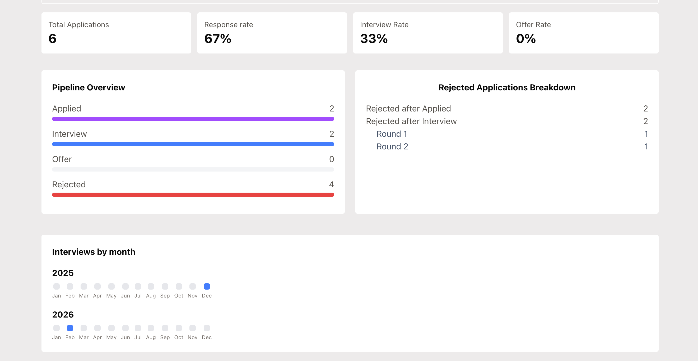

# Job Application Tracker
A React dashboard for tracking your job applications with pipeline visualizations

## Screenshots

### Dashboard Analytics


### Applications Table


## Features
- Upload job posting PDF and Claude autofills application fields
- Add and manage job applications
- Pipeline overview with stage breakdown
- Response rate, interview rate, and offer rate stats
- Visualize interview activity by month 
- Demo login with admin credentials

  
## Tech Stack
React · TypeScript · Vite · Supabase · Tailwind CSS · Vercel· Claude API

## Getting Started

### Prerequisites
- Anthropic API key
- Node.js 18+ (and npm)


Install dependencies
```bash
npm install
```

### Run
```
npm run dev
```

